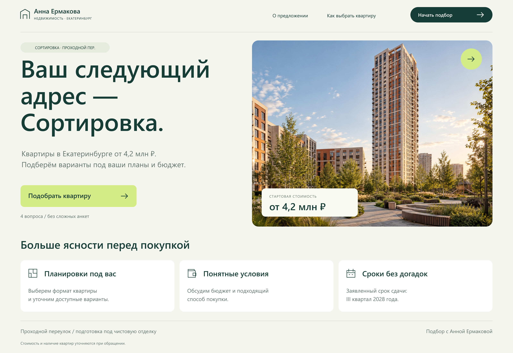

# Real Estate — Quiz Landing Concepts

Desktop/mobile landing concepts, quiz questions, contact and completion screens.

[Open gallery](https://memorim.github.io/real-estate-quiz-designs/)




## Implementation

HTML/CSS gallery with image previews and editable design assets. The gallery can be served directly; no application build or secret configuration is needed. Desktop and mobile compositions are separate assets.

## Local setup and checks

```bash
python tests/check_assets.py
python .github/scripts/check_docs.py
python -m http.server 8080 --bind 127.0.0.1
```

Use Python 3.12.14, matching CI. Open `http://localhost:8080`. CI checks asset references and documentation; it does not certify interactive behavior inside images.

## Scope and limits

The preview depicts a quiz; it does not submit leads, calculate mortgage eligibility or connect to Marquiz/CRM.

No database, migrations or API are required for this static scope. Forms or integrations would be a separate implementation task.

[Technical details](docs/TECHNICAL.md) · [Recorded checks](docs/VERIFICATION.md) · [Change history](CHANGELOG.md)
