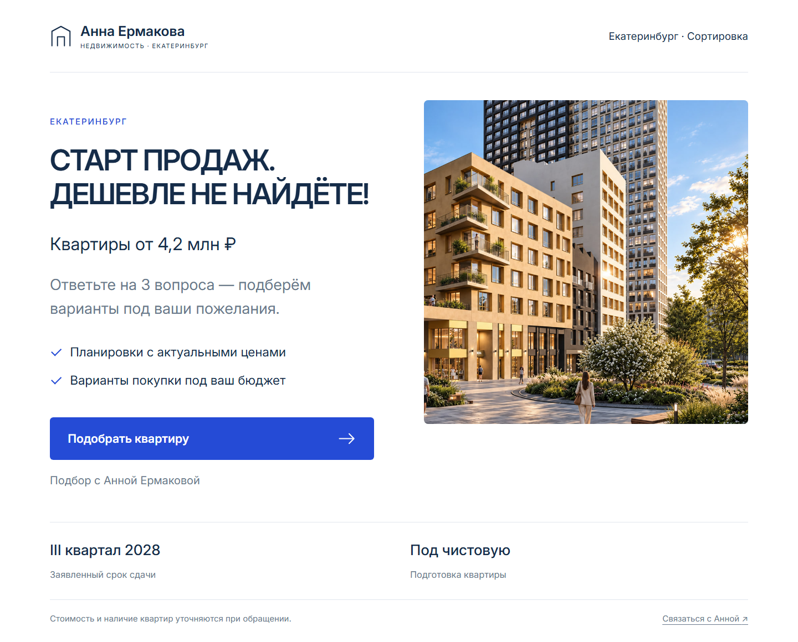
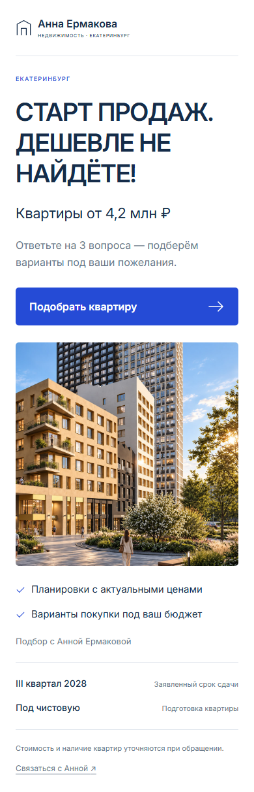

# Анна Ермакова — квартиры на Сортировке

Рабочий адаптивный лендинг с квизом Marquiz: подбор квартиры, бюджет, способ покупки и контактная форма.

[Открыть лендинг](https://memorim.github.io/real-estate-quiz-designs/anna-ermakova/) · [Версия на Render](https://anna-ermakova.onrender.com/)

[Подключение и проверка квиза](anna-ermakova/README.md). Галерея примерных дизайнов удалена; сайт находится только в `anna-ermakova/`.





## Устройство проекта

HTML, CSS и JavaScript без сборщика. Квиз принадлежит проекту Анны в Marquiz; контакты и заявки обрабатывает Marquiz. Если виджет не загрузился, кнопка открывает тот же квиз по прямой ссылке. Секретов в репозитории нет.

## Локальный запуск и проверки

Python 3.12.14, как в CI.

```bash
python tests/check_assets.py
node tests/check_quiz.mjs
node tests/check_quiz_design.mjs
python .github/scripts/check_docs.py
python -m http.server 8080 --bind 127.0.0.1
```

Откройте `http://localhost:8080/anna-ermakova/`. CI проверяет ресурсы лендинга, открытие квиза, резервную ссылку, прогресс и документацию.

[Технические сведения](docs/TECHNICAL.md) · [Выполненные проверки](docs/VERIFICATION.md) · [История изменений](CHANGELOG.md)
